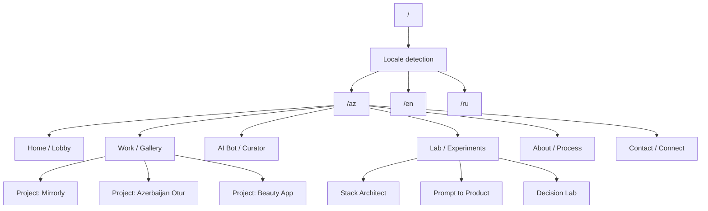

# AI-First Portfolio Master Plan

> Bu sənəd layihənin əsas icra sənədidir. Bu sənədi oxuyan insan və ya süni intellekt addımları sıra ilə, mərhələni ötürmədən icra etməlidir. Məqsəd sadəcə gözəl portfolio deyil, `AI-first engineer` kimi personal brand-i premium, çoxdilli, interaktiv və məhsul səviyyəsində təqdim edən bir platforma qurmaqdır.

## 0. Layihənin Məqsədi

Bu saytın əsas məqsədi personal brand qurmaqdır. Ziyarətçi sayta daxil olanda aşağıdakıları dərhal anlamalıdır:

1. Bu insan yüksək keyfiyyətə önəm verir.
2. Bu insan AI-ni sadəcə trend kimi yox, iş prosesinin real hissəsi kimi istifadə edir.
3. Bu insan mobile app və product thinking tərəfini güclü şəkildə bilir.
4. Bu insanla əməkdaşlıq etmək professional və dəyərli olacaq.
5. Sayt sadə portfolio deyil, interaktiv və yaradıcı bir təcrübədir.

Bu sənədin məqsədi bütün gələcək dizayn və development qərarlarını bir mərkəzdə toplamaqdır. Bu sənəd “source of truth” sayılır.

## 1. Əsas Brand Qərarları

### 1.1. Positioning

- Əsas kimlik: `AI-first engineer`
- İkinci kimlik: `iOS / mobile product builder`
- Üçüncü kimlik: `creative builder`
- Dördüncü kimlik: `product-minded engineer`

Bu sıralama vacibdir. Əsas mərkəz `AI-first engineer` olmalıdır. Qalan hər şey bunu dəstəkləməlidir.

### 1.2. Auditoriya

Əsas auditoriya:

- startup founder
- indie maker
- product decision maker
- technical founder
- remote hiring manager

İkinci dərəcəli auditoriya:

- recruiter
- design-aware engineers
- potential collaborators
- clients

### 1.3. Ton və Şəxsiyyət

- Ton: premium, ciddi, professional
- Şəxsiyyət: aydın, ağıllı, özünə inanan, amma iddiasız
- Dil: qısa, seçilmiş, məna daşıyan
- Emojilərdən, ucuz hype-dən və boş iddialardan qaçın
- Hər cümlə ya məlumat versin, ya da inam yaratsın

### 1.4. Brand Cümləsi

Əsas brand cümləsi bu xəttə yaxın olmalıdır:

`I build premium digital products as an AI-first engineer.`

Bu cümlə:

- sənin AI yanaşmanı göstərir
- məhsul yönünü göstərir
- premium keyfiyyət hissi yaradır
- professional və beynəlxalq səslənir

## 2. Layihənin Strateji Çərçivəsi

### 2.1. Layihə Tipi

Bu sayt klassik “portfolio page” deyil. Bu, aşağıdakıların qarışığıdır:

- personal brand platform
- product showcase
- AI experience
- interactive lab
- multilingual content site

### 2.2. Vizual Metafora

Saytın metaforası:

- `Home` = lobby
- `Work` = gallery
- `Bot` = curator desk
- `Lab` = experimental room
- `About` = process archive
- `Contact` = calm exit

Bu metafora həm dizayna, həm copy-yə, həm də interaksiyaya təsir etməlidir.

### 2.3. Vizual Hiss

İstədiyimiz ümumi hiss:

- premium dark
- old money tonları
- digital museum
- AI atelier
- modern product page
- motion-rich, amma kontrollu

## 3. Məhsul Qaydaları

Bu layihədə aşağıdakı qaydalar dəyişməzdir:

1. Hər section bir məqsədə xidmət etməlidir.
2. Hər animasiya yalnız dəyər verirsə əlavə olunmalıdır.
3. Bütün mətnlər lokallaşdırılmalıdır.
4. Mobil təcrübə desktop qədər ciddi qəbul edilməlidir.
5. AI bot real, dürüst və qısa davranmalıdır.
6. Fake metric, uydurma nəticə və boş marketinq dili istifadə edilməməlidir.
7. Performance dizayn qədər vacibdir.
8. Accessibility sonradan yox, əvvəlcədən düşünülməlidir.
9. Layout çox “template” kimi görünməməlidir.
10. Sayt bir məhsul kimi hiss olunmalıdır, sadəcə vizual vitrin kimi yox.

## 4. Texniki Yanaşma

### 4.1. Final Texnologiya Seçimi

Bu layihənin final versiyası üçün tövsiyə olunan stack:

- `Next.js`
- `TypeScript`
- `Tailwind CSS`
- custom `CSS variables`
- `Framer Motion`
- `GSAP` və ya `ScrollTrigger` seçilmiş motion anları üçün
- `Lenis` və ya ekvivalent smooth scrolling layer
- `next-intl` və ya bənzər localization sistemi
- serverless AI API route
- content-first data model
- `Vercel` deployment

### 4.2. Niyə Bu Stack

Bu seçim ona görə edilir ki:

- çoxdilli sayt üçün sağlamdır
- çox səhifəli struktur üçün uyğundur
- AI bot üçün serverless layer verir
- future-proof-dir
- SEO üçün əlverişlidir
- komponent əsaslı inkişafı dəstəkləyir
- sonradan light theme, CMS, memory və yeni lab-lar əlavə etmək asandır

### 4.3. Cari Repo Haqqında Qeyd

Hazırkı `index.html` faylı final sistemin özü deyil. Bu, başlanğıc referans və content prototype kimi qəbul edilməlidir. Final hədəf modul və genişlənə bilən tətbiq arxitekturasıdır.

## 5. Dil və Lokalizasiya Strategiyası

### 5.1. Dəstəklənən Dillər

- `AZ` default
- `EN` beynəlxalq istifadə üçün
- `RU` regional istifadə üçün

### 5.2. Dil Prioriteti

1. Brauzer dilini oxu.
2. Dəstəklənirsə həmin dili aç.
3. Dəstəklənmirsə `AZ` fallback et.
4. İstifadəçi istəsə manual switch etsin.

### 5.3. Lokalizasiya Qaydası

Bütün mətnlər sadəcə tərcümə olunmamalıdır. Hər dil üçün təbii lokal copy yazılmalıdır. Aşağıdakı elementlər ayrıca localizə olunmalıdır:

- navigation
- hero copy
- CTA-lar
- section headings
- project descriptions
- bot prompts
- lab labels
- contact text
- metadata

### 5.4. Bot Dil Davranışı

Bot istifadəçi hansı dildə yazırsa, həmin dildə cavab verməlidir. Əgər istifadəçi dildə qarışıqlıq edirsə, sistem avtomatik istifadə edilən dili əsas götürməlidir.

## 6. Sayt Xəritəsi

### 6.1. Global Route Strukturu

### 6.2. Route-ların Rolü

| Route | Rol | Əsas funksiyası |
|---|---|---|
| `/{locale}` | Home | İlk təəssürat, positioning, proof, AI teaser |
| `/{locale}/work` | Work | Layihələrin qalarisi və filtr sistemi |
| `/{locale}/work/[slug]` | Project detail | Dərin case study və sübut |
| `/{locale}/bot` | AI Bot | Söhbət, sual-cavab, guide |
| `/{locale}/lab` | Lab | Mini-game və eksperimentlər |
| `/{locale}/about` | About / Process | Şəxsi hekayə və iş metodu |
| `/{locale}/contact` | Contact | Əlaqə və əməkdaşlıq CTA-ları |

## 7. Home Page Məzmun Xəritəsi

Home səhifəsi bir məhsul page kimi işləməlidir. Burada ardıcıllıq vacibdir.

### 7.1. Hero

Məqsəd:

- kim olduğunu demək
- positioning-i bir cümlədə vermək
- premium hiss yaratmaq

Hero elementləri:

- title
- subtitle
- qısa supporting line
- locale-aware CTA
- subtle visual motion

### 7.2. Proof Strip

Məqsəd:

- real layihə, real platforma, real aktiv iş hissi vermək

Elementlər:

- live app badges
- app store linklər
- selected technology badges
- production indicators

### 7.3. Selected Work Teaser

Məqsəd:

- layihələrin keyfiyyətini və real məhsul düşüncəni göstərmək

Elementlər:

- 3 əsas project card
- hər kartda qısa nəticə
- media preview
- stack highlight

### 7.4. AI Bot Teaser

Məqsəd:

- sənin AI-first kimliyini sübut etmək

Elementlər:

- bot preview
- prompt chips
- “Ask about me” CTA
- supported language indicator

### 7.5. Lab Teaser

Məqsəd:

- yaradıcı tərəfini göstərmək

Elementlər:

- mini-game preview cards
- interactive result preview
- “Enter the Lab” CTA

### 7.6. Process Snapshot

Məqsəd:

- sənin necə işlədiyini göstərmək

Elementlər:

- how you work
- AI integration
- product thinking
- speed with quality

### 7.7. Final CTA

Məqsəd:

- istifadəçini son addıma yönləndirmək

CTA-lar:

- work
- bot
- contact

## 8. Work Page Məzmun Xəritəsi

### 8.1. Məqsəd

Work page sadə cards page olmamalıdır. Bu, curated gallery olmalıdır.

### 8.2. Bölmələr

1. Page intro
2. Project filter / categories
3. Featured projects
4. Project status / platform badges
5. Media preview
6. Quick open to detail page

### 8.3. Filtr Növləri

Filtrlər ehtiyac varsa bu tipdə ola bilər:

- AI / mobile
- live app
- concept
- iOS
- design-heavy

### 8.4. Project Card Standartı

Hər project card aşağıdakıları göstərməlidir:

- title
- one-line summary
- role
- stack
- media preview
- platform / status
- result hint

## 9. Project Detail Page Standartı

Hər layihə üçün eyni keyfiyyət sistemi tətbiq olunmalıdır.

### 9.1. Bölmələr

1. Project hero
2. Problem
3. Sənin rolun
4. AI istifadə qaydası
5. Texnologiyalar
6. Media / video / screenshot
7. Nəticə
8. Linklər
9. Next project

### 9.2. Hər Project üçün Minimum Məlumat

- title
- short summary
- long summary
- role
- stack
- date/status
- media
- external links
- outcome
- locale copies

### 9.3. Göstəriləcək Layihələr

- Mirrorly
- Azerbaijan Otur
- Beauty App

### 9.4. Media Qaydaları

- Video varsa, autoplay etməyə məcbur etmə
- Ağır media üçün poster istifadə et
- Linklər yeni tab-da açılsın
- Media loading performansa zərər verməsin
- Mobile-da media həmişə uyğun skala ilə işləsin

## 10. About / Process Page

### 10.1. Məqsəd

Bu səhifə sənin hekayəni, düşüncə tərzini və iş metodunu izah etməlidir.

### 10.2. Daxil Olmalı Məzmun

- kim olduğun
- nəyə fokuslandığın
- AI-ni necə istifadə etdiyin
- product thinking yanaşman
- iş sürətin
- keyfiyyət yanaşman
- istifadə etdiyin əsas alətlər
- real foto və ya AI avatar

### 10.3. Ton

- professional
- qısa
- premium
- dürüst
- iddiasız, amma güclü

## 11. Contact Page

### 11.1. Məqsəd

Əlaqə hissəsi sadəcə e-mail göstərmək üçün olmamalıdır. Bu hissə əməkdaşlıq üçün aydın yol verməlidir.

### 11.2. Əlaqə Kanalları

- email
- GitHub
- LinkedIn əgər varsa
- optional contact form

### 11.3. Contact CTA Qaydası

- “Let’s talk” kimi boş cümlələrdən qaçın
- konkret çağırış yaz
- istifadəçiyə nə üçün yazmalı olduğunu göstər
- founder və indie maker üçün əməkdaşlıq tonu yaz

## 12. AI Bot Sistemi

### 12.1. Botun Rolu

Bot sənin yerinə danışan “curator” kimi işləməlidir. Bu bot aşağıdakıları edə bilməlidir:

- sənin kim olduğunu izah etmək
- layihələri danışmaq
- AI ilə işləmə metodunu anlatmaq
- istifadəçini work və contact-a yönləndirmək
- dilə uyğun cavab vermək

### 12.2. Botun Mənbələri

Bot aşağıdakı structured məlumatlardan qidalanmalıdır:

- profile data
- project data
- FAQ entries
- locale copy
- tone rules

### 12.3. Bot Davranış Qaydaları

1. Dürüst ol.
2. Uydurma.
3. Qısa cavab ver.
4. Dərin sualda detallı cavab ver.
5. İstifadəçinin dilinə uyğunlaş.
6. Bilinməyən halda “mən bunu dəqiq bilmirəm” de və yönləndir.

### 12.4. Bot UI Standartı

- chatbot kimi “ucuz” görünməməlidir
- premium panel hissi verməlidir
- prompt chips olmalıdır
- typing state olmalıdır
- answer transitions yumşaq olmalıdır
- mobile-da çox yer tutmamalıdır

### 12.5. Bot üçün İlk Suallar

- Ramin kimdir?
- Nə iş görür?
- AI-ni işində necə istifadə edir?
- Hansı layihələr üzərində işləyib?
- Onunla necə əməkdaşlıq etmək olar?

## 13. Lab / Mini-Game Sistemi

### 13.1. Məqsəd

Lab bölməsi həm əyləncə, həm də portfolio dəyəri yaratmalıdır. Bu hissə sənin düşüncə tərzini göstərən bir təcrübə sahəsi olacaq.

### 13.2. İlkin Oyunlar

1. Stack Architect
2. Prompt to Product
3. Decision Lab

### 13.3. Oyun Qaydaları

- hər oyun qısa olmalıdır
- hər oyun nəticə çıxarmalıdır
- nəticə paylaşılabilən formatda olmalıdır
- oyunlar founder üçün də mənalı olmalıdır
- oyunun nəticəsi sənin portfolio-luna bağlanmalıdır

### 13.4. Oyun UX Prinsipləri

- drag-drop yalnız həqiqətən lazımdırsa istifadə et
- click-based flow daha sadədirsə onu seç
- mobil touch-friendly olmalıdır
- nəticə kartı aydın və paylaşılabilən olmalıdır

## 14. Design System

### 14.1. Rəng Palitrası

Əsas hiss:

- graphite
- ink
- obsidian
- warm ivory
- muted gold
- controlled cyan accent

### 14.2. Tipografiya Rolları

- display font: hero və section titles
- body font: normal content
- mono font: metadata, tags, bot, lab labels

### 14.3. Spacing və Rhythm

- böyük nəfəs
- editorial spacing
- cards arasında ritm
- sections arasında balans

### 14.4. Component Style

- cards: museum exhibit kimi
- buttons: premium, yumşaq radiuslu
- tags: minimal, müasir
- forms: ciddi, sadə, oxunaqlı

### 14.5. Motion Style

- subtle
- meaningful
- smooth
- overdone deyil
- hərəkət hissi premium olmalıdır

## 15. Responsive Strategiya

### 15.1. Mobile-First

Mobil prioritet əsasdır. Bu səbəbdən:

- navigation mobile-da rahat olmalıdır
- bot istifadəsi sadə olmalıdır
- cards oxunaqlı olmalıdır
- media adaptiv olmalıdır
- interactions touch-friendly olmalıdır

### 15.2. Breakpoint Qaydası

- small mobile
- large mobile
- tablet
- desktop
- large desktop

### 15.3. Mobile UX Qaydası

- hover-a əsaslanan kritik məlumat olmamalıdır
- uzun text blokları parçalanmalıdır
- AI bot full-screen və ya sheet kimi işləyə bilər
- lab oyunları sadə gestlarla işləməlidir

## 16. Accessibility Standartı

### 16.1. Əsas Qaydalar

- semantik HTML istifadə et
- heading hierarchy düzgün qurulsun
- focus state olsun
- keyboard navigation işləsin
- color contrast kifayət etsin
- reduced motion dəstəyi olsun
- icon-lar accessible label ilə işləsin

### 16.2. Accessibility Acceptance Criteria

- bütün linklər keyboard ilə çatılır
- locale switcher screen reader üçün başadüşüləndir
- bot mesajları screen reader-də oxunaqlı olur
- media üçün alt text / captions düşünülür

## 17. SEO və Social Visibility

### 17.1. SEO Əsasları

- locale-specific title
- locale-specific description
- canonical URL-lar
- `hreflang`
- sitemap
- robots
- structured data

### 17.2. Social Preview

Hər dil üçün və ya ən azı əsas dil üçün:

- OpenGraph image
- title
- description
- site name

### 17.3. SEO Məqsədi

SEO-nun əsas məqsədi bloq yaratmaq deyil. Əsas məqsəd:

- personal brand görünürlüğü
- founder və recruiter axtarışlarında görünmək
- layihələrin doğru təqdimatı

## 18. Analytics Plan

Ölçüləcək əsas event-lər:

- locale switch
- bot open
- bot question submit
- prompt chip click
- project open
- video play
- app store click
- github click
- contact click
- lab start
- lab completion

Bu analytics sonradan hansı hissənin işlədiyini və hansının işləmədiyini göstərmək üçün lazımdır.

## 19. Təhlükəsizlik və Etibarlılıq

### 19.1. AI Key Protection

- API key client tərəfində olmamalıdır
- bütün AI çağırışları serverless layer-dən keçməlidir

### 19.2. Rate Limit

- bot üçün rate limit
- abuse protection
- fallback mesajı

### 19.3. Fail-Safe Davranış

- AI cavab verməzsə user boş ekran görməməlidir
- media yüklənməzsə fallback göstərilməlidir
- locale fail olarsa `AZ` fallback olsun

## 20. Performans Standartı

### 20.1. Hədəf

Sayt premium görünməli, amma ağır olmamalıdır.

### 20.2. Qaydalar

- şəkillər optimallaşdırılmalıdır
- video lazy load ilə işləməlidir
- ağır motion yalnız seçilmiş bölmələrdə olsun
- component tree sadə qalsın
- third-party script-lər minimumda olsun

### 20.3. Performans Qəbul Meyarları

- mobil ilk açılış sürətli olmalıdır
- scroll lag olmamalıdır
- bot UI gecikmədən açılmalıdır
- media səhifəni bloklamamalıdır

## 21. Həyata Keçirmə Sırası

Bu ardıcıllıq pozulmamalıdır. Bir mərhələ qəbul edilmədən növbəti mərhələyə keçmək olmaz.

### Step 1. Scope Freeze

İcra:

- positioning kilidlə
- məqsədi təsdiqlə
- auditoriya təsdiqlə
- dili təsdiqlə
- tech stack təsdiqlə

Çıxış:

- yekun strategiya sənədi

### Step 2. Content Audit

İcra:

- bütün layihə linklərini topla
- video linkləri hazırla
- App Store linkini hazırla
- GitHub linkləri hazırla
- bio məlumatını topla
- real foto və ya avatar qərarı ver

Çıxış:

- content inventory

### Step 3. Information Architecture

İcra:

- sitemap qur
- route-ları müəyyən et
- locale sistemini yaz
- page məqsədlərini kilidlə

Çıxış:

- final route map

### Step 4. Data Model

İcra:

- profile schema yaz
- project schema yaz
- locale message structure qur
- bot knowledge base formatını qur
- lab experiment schema qur

Çıxış:

- structured content layer

### Step 5. Design Tokens

İcra:

- color tokens
- typography scale
- spacing tokens
- border radius
- shadow rules
- motion tokens

Çıxış:

- design system foundation

### Step 6. App Scaffold

İcra:

- Next.js app yarat
- TypeScript konfiqurasiya et
- localization routing qur
- global layout yarat
- shared header/footer hazırla

Çıxış:

- working shell

### Step 7. Home Page

İcra:

- hero
- proof strip
- selected work teaser
- AI teaser
- lab teaser
- process snapshot
- final CTA

Çıxış:

- content-rich home page

### Step 8. Work Gallery

İcra:

- project cards
- filters
- media preview
- open detail page

Çıxış:

- curated work page

### Step 9. Project Detail Pages

İcra:

- hər layihə üçün eyni detal şablonu
- problem / process / outcome
- media section
- external links

Çıxış:

- case study pages

### Step 10. About / Process

İcra:

- hekayə
- iş prinsipləri
- AI workflow
- tools
- avatar/photo section

Çıxış:

- trust-building page

### Step 11. Contact

İcra:

- email
- GitHub
- LinkedIn
- contact CTA

Çıxış:

- clean conversion section

### Step 12. AI Bot UI

İcra:

- bot panel
- prompt chips
- typing state
- locale-aware responses

Çıxış:

- interactive guide

### Step 13. AI Backend

İcra:

- serverless endpoint
- provider adapter
- fallback response
- prompt rules

Çıxış:

- functional AI integration

### Step 14. Lab Games

İcra:

- Stack Architect
- Prompt to Product
- Decision Lab

Çıxış:

- interactive lab

### Step 15. Motion Polish

İcra:

- reveal animations
- scroll effects
- hover feedback
- bot transitions
- page transitions

Çıxış:

- premium motion layer

### Step 16. Accessibility

İcra:

- focus states
- keyboard flow
- reduced motion
- semantic headings

Çıxış:

- accessible product

### Step 17. Performance

İcra:

- image optimization
- media optimization
- route split
- lazy loading
- bundle inspection

Çıxış:

- fast production build

### Step 18. SEO

İcra:

- metadata
- social previews
- hreflang
- sitemap
- canonical

Çıxış:

- discoverable site

### Step 19. QA

İcra:

- desktop check
- mobile check
- locale check
- bot check
- lab check
- media check

Çıxış:

- final bug list

### Step 20. Launch

İcra:

- Vercel deploy
- domain connect
- analytics activation
- monitoring activation

Çıxış:

- production-ready launch

### Step 21. Post-Launch Iteration

İcra:

- user feedback toplama
- bot təkmilləşdirmə
- content refinement
- lab genişləndirmə

Çıxış:

- iteration backlog

## 22. Definition of Done

Bu layihə yalnız aşağıdakılar tamamlandıqda bitmiş sayılır:

1. `AZ / EN / RU` tam işləyir.
2. Home page premium və aydındır.
3. Work page real case study keyfiyyəti verir.
4. AI bot səmərəli və dürüstdür.
5. Lab hissəsi düşüncəli və əyləncəlidir.
6. Mobile UX problemsizdir.
7. Accessibility uyğunluğu var.
8. SEO əsasları qurulub.
9. Performance qənaətbəxşdir.
10. Launch sonrası ölçmə sistemi aktivdir.

## 23. Review Rubric

Layihə tamamlandıqda bu suallara “bəli” cavabı verilməlidir:

- Sayt bir premium məhsul kimi görünür?
- İlk 10 saniyədə `AI-first engineer` obrazı aydın olur?
- Founder-lar üçün dəyər hiss olunur?
- Bot həqiqətən fərqləndirici elementdir?
- Lab hissəsi həm əyləncəli, həm meaningful-dur?
- Multilingual sistem professional görünür?
- Mobile experience güclüdür?
- Motion kontrolludur?
- Sayt template kimi deyil, custom product kimi hiss olunur?

Əgər bu suallardan biri mənfidirsə, həmin hissə yenidən işlənməlidir.

## 24. Başlamazdan Əvvəl Lazım Olan Məlumatlar

Layihəyə keçməzdən əvvəl bu materiallar toplanmalıdır:

- `Azerbaijan Otur` video linki
- `Beauty App` video linki
- `Mirrorly` App Store linki
- hər layihə üçün qısa təsvir
- real foto və ya AI avatar qərarı
- logo / monogram qərarı
- LinkedIn linki
- GitHub linki
- email
- varsa digər sosial profillər

## 25. Qırmızı Xətlər

Aşağıdakı şeylər edilməməlidir:

- ucuz template hissi
- boş “AI-powered” yazıları
- həddindən artıq neon
- çox oyun kimi görünən vizual
- layout overload
- lazımsız şəkildə çox effekt
- yalançı metriklər
- qeyri-peşəkar copy
- mobil UX-i qıran elementlər

## 26. Son Qeyd

Bu planın məqsədi yalnız “gözəl sayt” yaratmaq deyil. Məqsəd:

- sənin brand-ni premium etmək
- AI-first mühəndis kimi mövqeləndirmək
- founder və indie maker auditoriyasını cəlb etmək
- real iş keyfiyyətini göstərmək
- yaratdıqlarına interaktiv dəyər əlavə etmək

Bu sənəd sonradan AI-yə oxudulacaq icra planıdır. Ona görə hər addım sıra ilə, keyfiyyətlə və qəbul meyarları ilə tamamlanmalıdır.
